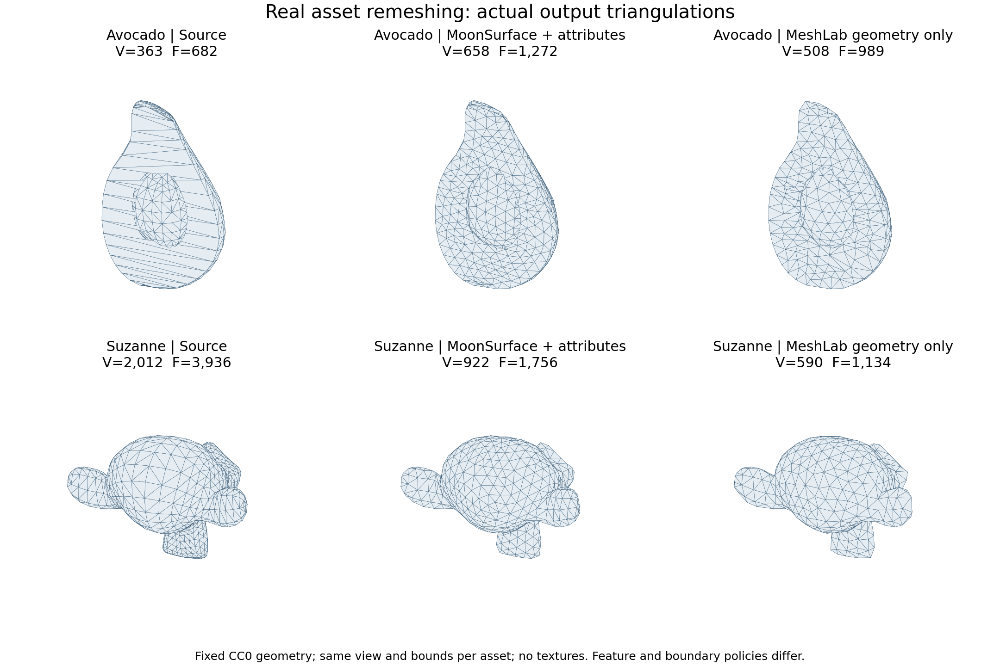
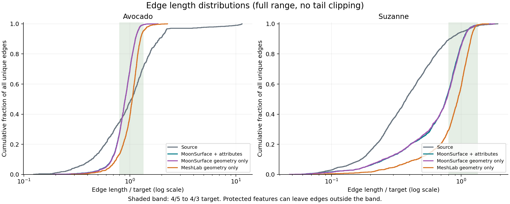

# Real models, independent checks and external comparison

2026-11-11, candidate `0.2.0-alpha.1`. Measured clean source:
[`483f4e8`](https://github.com/ShiChengxu-creater/MoonSurface/commit/483f4e8845c4b0eafb8a85ef0408d97d8334b63b).
The machine report is [evidence/model-feedback.json](evidence/model-feedback.json).
It records compiler, platform, parameters, source hashes and actual output hashes.
These are two asset-scale experiments, not evidence for arbitrary industrial mesh sizes.

## Inputs and reproduction

The fixed Khronos glTF Sample Assets revision is
`8f492390ddc7a2ae221a1369ef560589cf8c70fb`. Both assets are CC0-1.0:
[Avocado source and attribution](../fixtures/real/avocado/SOURCE.md),
[Suzanne source and attribution](../fixtures/real/suzanne/SOURCE.md).
Avocado is credited to Microsoft; Suzanne to Norbert Nopper/UX3D. Avocado's source
describes hand-painted textures; this report does not call it scanned data.

The extractor uses the first/only mesh in mesh-local coordinates, exactly welds
equal positions, retains original per-corner UV0/material ids and tags authored
normal discontinuities. It ignores scene transforms and textures. It rejects
invalid input instead of silently repairing it. Neither selected asset contributes
an authored-normal seam; sharp-feature and two-sided seam behavior also have a
dedicated folded synthetic example and tests. `position_probe` is an explicitly
added analytic validation channel, not an original artist-authored attribute.

| Asset | Input V / F | Components / boundary loops / Euler | Target edge length |
| --- | ---: | ---: | ---: |
| Avocado | 363 / 682 | 2 / 1 / 3 | 0.003673150373417551 |
| Suzanne | 2012 / 3936 | 3 / 4 / 2 | 0.1670082803268749 |

```sh
python -m pip install -r requirements-reference.txt
python tools/model_verify.py --target js --real --reference
```

This runs six seeded grids, four deliberately corrupted-result controls and the
two real assets. The output report names a directory containing all original job
and output JSON files. `prepare_models.py` can re-extract the pinned source assets;
the checked-in jobs require no network. For figures, install the optional
`requirements-report.txt` and run `python tools/render_model_report.py`.

## Results

All figures use actual output triangles, not reconstructed illustrations.
The camera and bounds are shared per asset. The external reference has no input UV.



Q is `4*sqrt(3)*area / sum(edge_length^2)` (1 for an equilateral triangle).
Edge CV is the population standard deviation divided by mean unique-edge length;
lower means a narrower length distribution. Minimum angle is global, not a mean.

| Asset / mode | Output V / F | Minimum angle ° | Mean Q | Edge CV | Boundary edges |
| --- | ---: | ---: | ---: | ---: | ---: |
| Avocado source | 363 / 682 | 1.893 | 0.73739 | 1.08864 | 38 |
| MoonSurface + attributes | 658 / 1272 | 2.876 | 0.91254 | 0.20779 | 38 |
| MoonSurface geometry only | 656 / 1268 | 2.876 | 0.91297 | 0.20513 | 38 |
| MeshLab geometry only | 508 / 989 | 15.133 | 0.89838 | 0.21163 | 21 |
| Suzanne source | 2012 / 3936 | 7.776 | 0.78491 | 0.63580 | 84 |
| MoonSurface + attributes | 922 / 1756 | 7.776 | 0.80478 | 0.40899 | 84 |
| MoonSurface geometry only | 918 / 1748 | 7.776 | 0.79971 | 0.41504 | 84 |
| MeshLab geometry only | 590 / 1134 | 4.797 | 0.86736 | 0.31048 | 42 |

The independent topology reconstruction preserves each input's component count,
boundary-loop count and Euler characteristic in every mode. Boundary-edge counts
can differ because MeshLab coarsens boundary chains. MoonSurface pins all feature
vertices and does not coarsen those chains. It also refuses edits below its
effective angle floor; these policies constrain the output and face count.
MeshLab gives a better Avocado minimum angle and better Suzanne mean Q/CV in
this experiment. The tables support no blanket superiority claim.



The shaded interval is 4/5–4/3 of the target. Curves include every edge and use
logarithmic x axes. Constraints leave many Suzanne edges outside that interval;
the algorithm reports iteration-limit termination rather than claiming universal
target attainment. Remeshing can increase or decrease face count; it is not a
target-face-count QEM simplifier.

## Geometry distance and attribute/feature checks

Independent closest-point measurements use plane Gram systems plus the three
segment minima over a face list, not the production BVH/closest-region routine.
Each direction samples up to 512 evenly indexed vertices and 512 evenly indexed
face centroids. RMS is over the combined two-direction sample set. Changing
triangulation changes sample locations; these measurements are not a continuous
Hausdorff bound or a uniform random surface estimate.

| Asset / mode | Source→output / output→source samples | Maximum / input diagonal | RMS, object units |
| --- | ---: | ---: | ---: |
| Avocado + attributes | 875 / 1024 | 0.6997% | 0.0000929023 |
| Avocado geometry only | 875 / 1024 | 0.8004% | 0.000100924 |
| Avocado MeshLab | 875 / 1020 | 0.8938% | 0.000138087 |
| Suzanne + attributes | 1024 / 1024 | 1.1228% | 0.00730701 |
| Suzanne geometry only | 1024 / 1024 | 1.1228% | 0.00737050 |
| Suzanne MeshLab | 1024 / 1024 | 1.2567% | 0.0110101 |

| Attributed check | Avocado | Suzanne |
| --- | ---: | ---: |
| Original protected edges / vertices | 87 / 88 | 304 / 352 |
| Reference patches | 4 | 6 |
| Maximum pinned vertex drift | 8.67e-19 | 1.24e-16 |
| Sampled UV barycentric absolute error | 6.88e-15 | 2.22e-16 |
| Analytic position channel maximum error | 6.94e-18 | 4.44e-16 |

The checker reconstructs constraints independently and checks every original
protected segment is covered by output feature segments without gaps. Every
original protected vertex must survive, with drift below diagonal*1e-9. For each
reference patch, up to 80 output faces' corners are projected independently to
that source patch to check UV interpolation (tolerance 2e-6). Every output face's
material must match its patch, and all output corner normals must be finite/unit.
These checks do not assert arbitrary custom-normal preservation or every UV
corner's interpolation accuracy. Unit/discrete interpolation and conflicting
edits have separate synthetic tests. Negative controls corrupt position data,
UV, statistics and feature output, and each must be rejected by the checker.

Real-asset gates require preserved topology/constraints, an unlowered effective
minimum angle, improved edge CV and nondecreased mean Q, with sampled max/diagonal
below 2%. Both pass. These gates apply to these fixed fixtures; they are not global
algorithm guarantees. The production witness guard separately uses seven samples
per original face and proposed face samples, with default limit target/4.

## External reference and interpretation

The optional PyMeshLab version is `2025.7.post1`, run in an independent subprocess
by [reference_tools/meshlab_reference.py](../reference_tools/meshlab_reference.py).
Its filter is `meshing_isotropic_explicit_remeshing`: three iterations, the same
absolute target length, feature angle 45°, split/collapse/swap/smooth/reproject on,
adaptive mode off, surface-distance checking at 1% input diagonal. MoonSurface also
uses three rounds and 45°, but applies its own pinned-feature policy, angle floor
and target/4 sample guard. We include both attributed and geometry-only MoonSurface
jobs so removing UV/material constraints is visible. The reference does not verify
MoonSurface's attribute handling, and its reported 1% filter setting is not an
independent 1% bound (Suzanne's measured sample maximum is 1.2567%).

The report retains elapsed times for diagnosis. MoonSurface measurements include
Node process startup and JSON serialization, while reference times cover the
MeshLab filter only. They cannot substantiate a speed comparison. There is no
current large-mesh or RSS benchmark and no QEM implementation. The independent
checker and product were AI-assisted; agreement is evidence, not a human oracle
or proof. See [MODEL_CONTRACT.md](MODEL_CONTRACT.md) and [AI_USAGE.md](../AI_USAGE.md).
